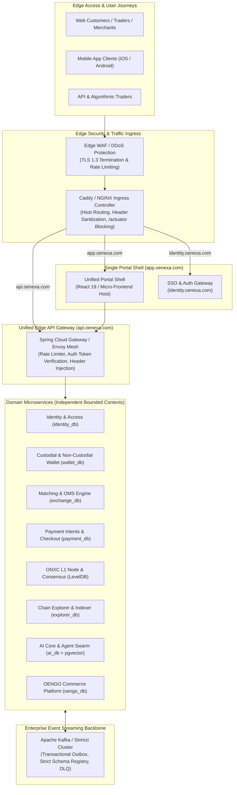
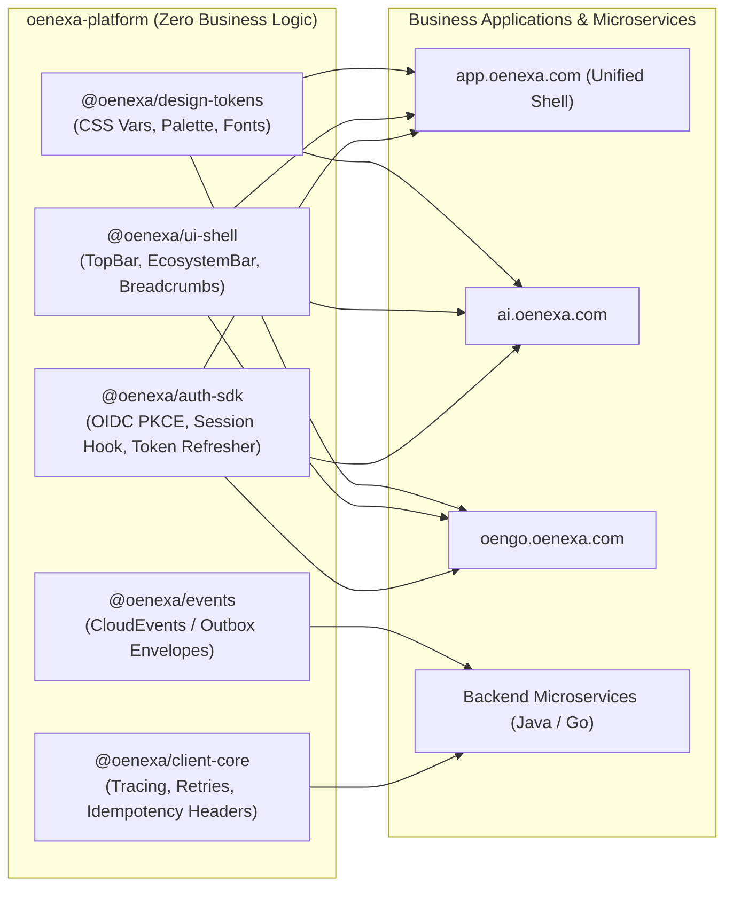
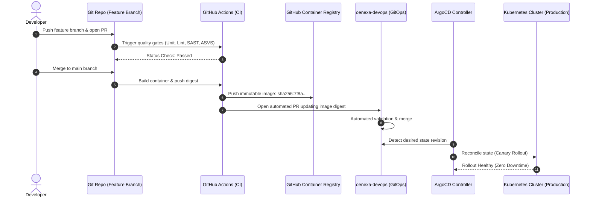
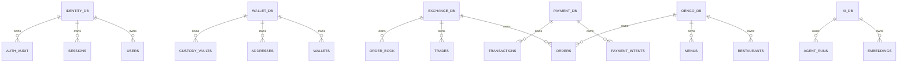
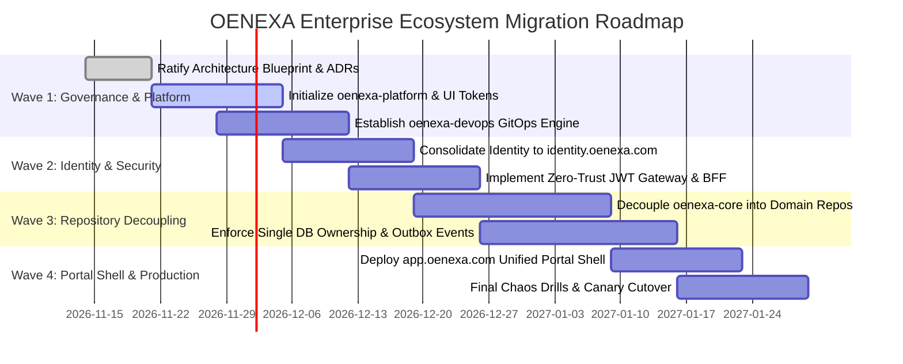

# OENEXA Unified Ecosystem — Master Enterprise Architecture, Governance & Operating Model

> **Authoritative Baseline:** OENEXA Engineering Executive & Architecture Board  
> **Classification:** Confidential / Enterprise Architecture Baseline (v3.0.0)  
> **Status:** Ratified Master Standard — Pre-Requisite to Further Feature Development  
> **Canonical Customer Portal:** `https://app.oenexa.com` | **Identity Authority:** `https://identity.oenexa.com`  
> **Enforcement Scope:** All Platform, Business, Infrastructure, and Security Repositories across the OENEXA Global Ecosystem.

---

## Executive Charter & Core Principles

The OENEXA ecosystem is a high-throughput, multi-asset financial, blockchain, AI, payment, and commerce ecosystem. This blueprint establishes the non-negotiable architectural mandates, repository boundaries, platform contracts, and operational governance models that govern all future development.

### Mandatory Engineering Rules
1. **No Monoliths & No Shared Databases:** No two microservices share a database instance, schema, or tables. Direct cross-service database access is strictly prohibited. Communication occurs exclusively via versioned REST/gRPC/JSON-RPC contracts and asynchronous Kafka domain events.
2. **Zero-Trust Identity (`identity.oenexa.com`):** All human and machine identities authenticate through `identity.oenexa.com` via OAuth 2.1 / OIDC (PKCE, RS256/EdDSA JWTs, rotating JWKS). Passwords and session state are never duplicated across business services.
3. **Single User-Facing Portal (`app.oenexa.com`):** All customer journeys begin and operate within `https://app.oenexa.com`. Products (`/exchange`, `/wallet`, `/pay`, `/blockchain`, `/ai`, `/oengo`, `/settings`) are mounted into a unified, authenticated shell.
4. **Pure GitOps Deployment:** No manual production modifications, no direct SSH deployments, no imperative `kubectl apply`, and no console edits. All environments (Dev, Staging, Production) are reconciled continuously by ArgoCD from Git.
5. **No Undocumented APIs or Infrastructure:** Every API exposes an OpenAPI 3.1 / AsyncAPI contract; every infrastructure resource is managed via declarative Infrastructure as Code (Terraform / OpenTofu).
6. **No Hardcoded Secrets:** Symmetric HMAC secrets and committed keystores are eliminated. Secrets are provisioned through HashiCorp Vault / Scaleway Secret Manager and injected at runtime via Kubernetes ExternalSecrets.

---

## Deliverable 1: Target Enterprise Architecture



---

## Deliverable 2 & 3: Repository Strategy & Ownership Matrix

To eliminate repository sprawl and monolithic coupling, the OENEXA ecosystem is structured into three discrete repository tiers: **Platform**, **Business Domains**, and **Governance**.

| Repository | Tier | Primary Owner | Technology Stack | Core Responsibility |
| :--- | :--- | :--- | :--- | :--- |
| **`oenexa-architecture`** | Governance | Enterprise Architecture Board | Markdown / ADRs / C4 Models | Ecosystem standards, ADR repository, blueprints |
| **`oenexa-standards`** | Governance | Quality & DevSecOps | Linters / Checkstyle / Semgrep | Universal linting rules, OpenAPI linting, git hooks |
| **`oenexa-platform`** | Platform | Platform Engineering | TypeScript / Java / Go | Shared SDKs, design tokens, event envelopes, UI shell |
| **`oenexa-devops`** | Platform | SRE & Cloud Engineering | ArgoCD / Helm / Kustomize | GitOps manifests, environment topologies, observability |
| **`oenexa-infra`** | Platform | Infrastructure Engineering | Terraform / OpenTofu | Cloud VPCs, managed databases, clusters, DNS, storage |
| **`oenexa-security`** | Platform | Security & IAM Architecture | Open Policy Agent / Trivy | Security baselines, threat models, Vault/WAF policies |
| **`oenexa-docs`** | Platform | Technical Documentation | Docusaurus / Markdown | Public API specs, architecture guides, onboarding docs |
| **`oenexa-identity`** | Business | Identity & IAM Team | Java 25 / Spring Auth Server | OIDC/OAuth2 authority, MFA, sessions, credentials |
| **`oenexa-wallet`** | Business | FinTech Core Team | Java 25 / Spring Boot / MySQL | Custodial balances, vaults, address generation, sweeps |
| **`oenexa-pay`** | Business | Payments Team | Java 25 / Spring Boot / MySQL | Tri-rail checkout, fiat gateways, payment intents |
| **`oenexa-exchange`** | Business | Trading Systems Team | Go 1.26 / LMAX Disruptor / Java | Order book, matching engine, order routing, fills |
| **`oenexa-market-data`** | Business | Market Data Team | Go 1.26 / WebSocket / Redis | Real-time tickers, orderbook depth, historic OHLCV |
| **`oenexa-liquidity`** | Business | Risk & Quantitative Team | Java 25 / Go | Liquidity aggregation, external market connectors |
| **`oenexa-node`** | Business | Blockchain Core Team | Go 1.26 / libp2p / LevelDB | Quantum-safe L1 node (ML-DSA-65/ML-KEM-768), JSON-RPC |
| **`oenexa-validator`** | Business | Blockchain Core Team | Go 1.26 / HSM Interop | Consensus validator daemon, block producer, slashing protection |
| **`oenexa-explorer`** | Business | Blockchain Tooling Team | React 18 / Node 24 / Vite | Block, transaction, and validator visual explorer |
| **`oenexa-contracts`** | Business | Smart Contracts Team | Solidity / Rust / Hardhat | Native cross-chain bridge, escrow contracts, token specs |
| **`oenexa-ai`** | Business | AI Systems Team | Java 25 / Spring AI / PGVector | Agent swarm orchestrator, reasoning engine, task manager |
| **`oenexa-rag`** | Business | AI Systems Team | Python 3.12 / FastAPI / Qdrant | Retrieval-augmented generation, embeddings, vector indexing |
| **`oenexa-agents`** | Business | AI Systems Team | Python 3.12 / LangGraph | Autonomous code review, issue handling, dev execution |
| **`oengo-customer`** | Business | Commerce Team | Next.js 16 / React 19 | Customer food ordering, storefront, tracking, checkout |
| **`oengo-merchant`** | Business | Commerce Team | Next.js 16 / React 19 | Restaurant portal, menu management, KDS order dispatch |
| **`oengo-driver`** | Business | Commerce Team | React Native / TypeScript | Courier delivery app, GPS routing, delivery confirmation |
| **`oengo-admin`** | Business | Operations & Commerce | Next.js 16 / React 19 | Regional operations, merchant onboarding, dispute console |

---

## Deliverable 4: Target Repository Tree Structure

```text
oenexa-ecosystem/
├── governance/
│   ├── oenexa-architecture/             # Architecture Decision Records (ADRs), C4 specs
│   └── oenexa-standards/                # Universal ESLint, Spotless, Semgrep, Checkstyle rules
├── platform/
│   ├── oenexa-platform/                 # Core SDKs, UI design tokens, event envelopes
│   │   ├── packages/
│   │   │   ├── design-tokens/           # Universal CSS variables & Tailwind presets
│   │   │   ├── ui-shell/                # Shared header, navigation bar, account switchers
│   │   │   ├── auth-sdk/                # OIDC PKCE client library (Web & Node)
│   │   │   ├── event-schemas/           # Avro / JSON Schema domain event definitions
│   │   │   └── api-client-base/         # Standardized HTTP/gRPC client interceptors
│   ├── oenexa-devops/                   # GitOps root repository
│   │   ├── apps/                        # ArgoCD Application definitions per domain
│   │   ├── helm/                        # Standardized microservice Helm charts
│   │   ├── environments/                # Overlays (dev, staging, prod)
│   │   └── observability/               # Prometheus rules, Grafana dashboards, Alertmanager
│   ├── oenexa-infra/                    # Terraform / OpenTofu Infrastructure as Code
│   │   ├── modules/                     # Reusable cloud modules (VPC, EKS/Kapsule, RDS, Kafka)
│   │   └── environments/                # Cloud environment instantiations (prod, staging)
│   ├── oenexa-security/                 # OPA policies, Vault configurations, WAF rules
│   └── oenexa-docs/                     # Developer portal documentation site
├── business/
│   ├── identity/ (oenexa-identity)
│   ├── fintech/  (oenexa-wallet, oenexa-pay, oenexa-exchange, oenexa-market-data, oenexa-liquidity)
│   ├── chain/    (oenexa-node, oenexa-validator, oenexa-explorer, oenexa-contracts)
│   ├── ai/       (oenexa-ai, oenexa-rag, oenexa-agents)
│   └── oengo/    (oengo-customer, oengo-merchant, oengo-driver, oengo-admin)
```

---

## Deliverable 5: Platform Architecture (`oenexa-platform`)

`oenexa-platform` is the foundational dependency tier. It contains zero product-specific business logic and zero persistence logic.



### Invariant Rules
- **Dependency Flow Rule:** Platform may **never** import or depend upon any business repository. Business repositories consume platform packages via published private registry packages (`@oenexa/*` via GitHub Packages).
- **SemVer Strictness:** All platform packages enforce Semantic Versioning with automated changelogs. Breaking changes require major version increments and a 30-day deprecation cycle.

---

## Deliverable 6: DevOps Architecture (`oenexa-devops`)

Continuous delivery across OENEXA is governed by GitOps through ArgoCD. Direct manual changes to Kubernetes clusters are forbidden and revoked automatically by automated drift correction.



### Environment Promotion Stages
1. **Development (`dev`):** Automatic continuous sync from `main` merges.
2. **Staging (`staging`):** Automated promotion upon green end-to-end integration test pass.
3. **Production (`prod`):** Gatekeeper-approved pull request promotion with Argo Rollouts canary deployment (10% -> 25% -> 50% -> 100% with automated metric analysis on error rates and latency).

---

## Deliverable 7: Infrastructure Architecture (`oenexa-infra`)

All cloud infrastructure is declared in Terraform / OpenTofu with remote state stored in encrypted Scaleway / AWS S3 buckets with distributed locking.

### Topology Specifications
- **Dedicated Metal Layer:** Bare-metal dedicated instances for `oenexa-node` L1 validator and GPU inference nodes (`Ollama / LLMs`), ensuring predictable NVMe I/O performance and direct P2P socket handling on TCP `8765`.
- **Managed Compute Layer:** Scaleway Kapsule (Kubernetes 1.30+) for all containerized stateless and stateful domain services.
- **Managed Data Tier:** Managed PostgreSQL HA (with `pgvector` for AI context), Managed MySQL 8.4/9.0 HA for financial core services, Managed Redis 7+ cluster for caching and rate limiting, and dedicated Scaleway Private Networks (VPC) with zero public IP exposure for data stores.

---

## Deliverable 8 & 9: Security & Identity Architecture

### Threat Model & Zero-Trust IAM
- **Identity Provider (`identity.oenexa.com`):** Spring Authorization Server acting as authoritative OIDC Identity Provider with cryptographic key rotation (`RS256` / `Ed25519` via `/.well-known/jwks.json`).
- **Token Claims Standard:**
  ```json
  {
    "iss": "https://identity.oenexa.com",
    "sub": "usr_98a7f012-4c2b-4e6a-bf09-8b9a11223344",
    "aud": ["https://api.oenexa.com"],
    "email": "trader@oenexa.com",
    "roles": ["ROLE_TRADER", "ROLE_KYC_VERIFIED"],
    "scopes": ["trade:execute", "wallet:read", "ai:run"],
    "kyc_tier": "TIER_2_VERIFIED",
    "amr": ["pwd", "passkey"],
    "jti": "tok_01J9...",
    "exp": 1794500000,
    "iat": 1794499100
  }
  ```
- **Edge Token Termination & BFF:** Single-page applications at `app.oenexa.com` store zero JWT tokens in `localStorage`. Tokens are maintained in HttpOnly, Secure, SameSite=Strict cookies scoped to `.oenexa.com`.

---

## Deliverable 10 & 11: Governance Framework & Domain Ownership Model

### Domain Data Boundaries
Every business domain possesses its own isolated database instance or strictly isolated schema with dedicated database service credentials.



### Invariant Rules
- Direct SQL queries across databases are strictly prohibited.
- Foreign keys between domains are strictly forbidden; references are maintained via immutable UUID identifiers (`owner_sub`, `order_id`, `wallet_id`).

---

## Deliverable 12 & 13: API & Event Governance Models

### API Standards
- **RESTful Endpoints:** Standardized kebab-case URIs, semantic HTTP status codes, and RFC 7807 Problem Details for all errors.
- **Idempotency:** Every mutating financial and payment request must supply an `Idempotency-Key` header, cached in Redis with distributed locks.
- **Versioning:** URL path versioning (`/api/v1/...`). Breaking API changes require minimum 90-day deprecation notice with telemetry alerting on deprecated consumers.

### Event Governance (CloudEvents Specification)
Every event emitted across Apache Kafka follows the strict Outbox Envelope:
```json
{
  "specversion": "1.0",
  "id": "evt_01J...",
  "source": "https://api.oenexa.com/wallet",
  "type": "com.oenexa.wallet.transfer.confirmed",
  "datacontenttype": "application/json",
  "time": "2026-11-14T01:30:00Z",
  "subject": "usr_98a7f012",
  "traceparent": "00-4bf92f3577b34da6a3ce929d0e0e4736-00f067aa0ba902b7-01",
  "data": {
    "transferId": "trf_87a1",
    "amount": "1500.00",
    "currency": "ONXC",
    "status": "SETTLED"
  }
}
```

---

## Deliverable 14 & 15: GitOps Architecture & Deployment Governance

### Enforcement Policy
- **Branch Protection:** All `main` branches require:
  - Minimum 2 senior peer reviews.
  - Required green status checks for CI tests, linting, security scans, and coverage gates (>80% instruction, >75% branch).
  - Signed commits (GPG / SSH).
- **Zero-Drift Policy:** Any resource modified outside of Git is overwritten automatically by ArgoCD within 3 minutes.

---

## Deliverable 16, 17 & 18: SRE, Security & Disaster Recovery Operating Models

### Service Level Objectives (SLOs) & Error Budgets

| Service Tier | Critical SLIs | Availability Target (SLO) | Latency P99 Target | RTO | RPO |
| :--- | :--- | :--- | :--- | :--- | :--- |
| **Tier 0: Core Chain & Matching** | RPC availability, block production, order matching latency | 99.99% | < 5ms (Matching), < 50ms (RPC) | < 5 min | 0 (Zero Loss) |
| **Tier 1: Identity & Wallet** | Auth success rate, balance retrieval, signature validity | 99.95% | < 100ms | < 15 min | < 1 min |
| **Tier 2: AI & Commerce (OENGO)** | Job completion rate, cart/checkout success rate | 99.9% | < 300ms | < 30 min | < 5 min |
| **Tier 3: Docs & Explorer** | HTTP 200 rate, index freshness | 99.5% | < 500ms | < 2 hours | < 1 hour |

### Disaster Recovery Runbook Matrix
- **Database Backups:** Continuous Write-Ahead Log (WAL) archiving to off-site object storage with automated hourly PITR (Point-In-Time Recovery) validation.
- **Failover Drills:** Monthly automated Chaos Engineering drills (Chaos Mesh) injecting pod crashes, network latency, and database primary failovers.

---

## Deliverable 19: Compliance Framework

The OENEXA ecosystem aligns strictly with international regulatory standards:
1. **PCI-DSS v4.0:** Zero cardholder data stored on OENEXA servers; tokenized via Tier-1 payment partners.
2. **SOC 2 Type II & ISO 27001:** Mandatory audit trails across all services via `oenexa-audit-service` with WORM (Write Once, Read Many) storage.
3. **GDPR / CCPA:** Dedicated `identity.user.deleted` event triggering cryptographically verified data erasure across all domain storage layers.
4. **MiCA (Markets in Crypto-Assets) & Travel Rule:** Automated AML and sanctions screening on all deposits and withdrawals exceeding thresholds via `oenexa-compliance-service`.

---

## Deliverable 20: RACI Governance Matrix

| Lifecycle Stage / Artifact | Executive (CTO/Chief Arch) | Domain Architect | Principal Engineer | DevSecOps / SRE | QA Architect |
| :--- | :--- | :--- | :--- | :--- | :--- |
| **Architecture Decision Records (ADRs)** | Approver | Accountable | Responsible | Consulted | Informed |
| **New Repository Creation** | Approver | Accountable | Responsible | Consulted | Informed |
| **Database Schema Modifications** | Informed | Accountable | Responsible | Consulted | Consulted |
| **Breaking API Changes** | Approver | Accountable | Responsible | Consulted | Responsible |
| **GitOps Deployment Manifests** | Informed | Consulted | Responsible | Accountable | Informed |
| **Production Incident Resolution** | Informed | Consulted | Responsible | Accountable | Informed |
| **Security Audits & Pentests** | Approver | Consulted | Consulted | Accountable | Consulted |

---

## Deliverable 21: Production Readiness Framework

Before any service is deployed to production, it must clear the Production Readiness Gate:
- [ ] **Observability:** Prometheus metrics (`/actuator/prometheus` or `/metrics`), OpenTelemetry distributed tracing, structured JSON logging with correlation IDs.
- [ ] **Security:** Static Application Security Testing (SAST) passed, container image vulnerability scan (Trivy) zero HIGH/CRITICAL CVEs, no hardcoded secrets (TruffleHog).
- [ ] **Resilience:** Health check probes configured (`livenessProbe`, `readinessProbe`, `startupProbe`), CPU/memory requests and limits defined, graceful shutdown handled.
- [ ] **Documentation:** OpenAPI 3.1 specification published, Runbook and Incident Escalation path documented.

---

## Deliverable 22: Migration Strategy (Phase-by-Phase)

A zero-downtime 4-wave migration plan transitions the existing deployment to the target architecture:



---

## Deliverable 23: Risk Assessment Matrix

| Risk Category | Identified Hazard | Impact | Likelihood | Mitigation Strategy |
| :--- | :--- | :--- | :--- | :--- |
| **Architectural** | Repository splitting causes cross-repo version drift | High | Medium | Strict SemVer on platform packages; automated cross-repo dependency validation via Renovate. |
| **Operational** | Database decoupling leads to distributed transaction failures | High | Low | Enforce Transactional Outbox pattern with idempotent event consumers and saga compensations. |
| **Security** | OIDC token theft during cross-domain navigation | Critical | Low | SameSite=Strict HttpOnly session cookies; short-lived access tokens (15m) with refresh token rotation. |
| **Performance** | Micro-frontend mounting overhead degrades user experience | Medium | Low | Code splitting, shared module federation, aggressive CDN caching of static assets. |

---

## Deliverable 24: Final Engineering Recommendations

1. **Lock Repository Boundaries:** Halt direct feature work in the monolithic `oenexa-core` and split into focused domain repositories (`oenexa-identity`, `oenexa-wallet`, `oenexa-pay`, `oenexa-exchange`).
2. **Deploy `oenexa-platform` First:** Extract shared design tokens, auth SDK, and event schemas into `@oenexa/platform` so all downstream repositories consume identical, versioned primitives.
3. **Mandate GitOps Immediately:** Cease all direct Docker Compose and SSH deployments. Migrate environment manifests into `oenexa-devops` under ArgoCD governance.
4. **Enforce `app.oenexa.com` as the Sole Customer Gateway:** Ensure all user flows route through the unified shell, backed by `identity.oenexa.com` single sign-on.
