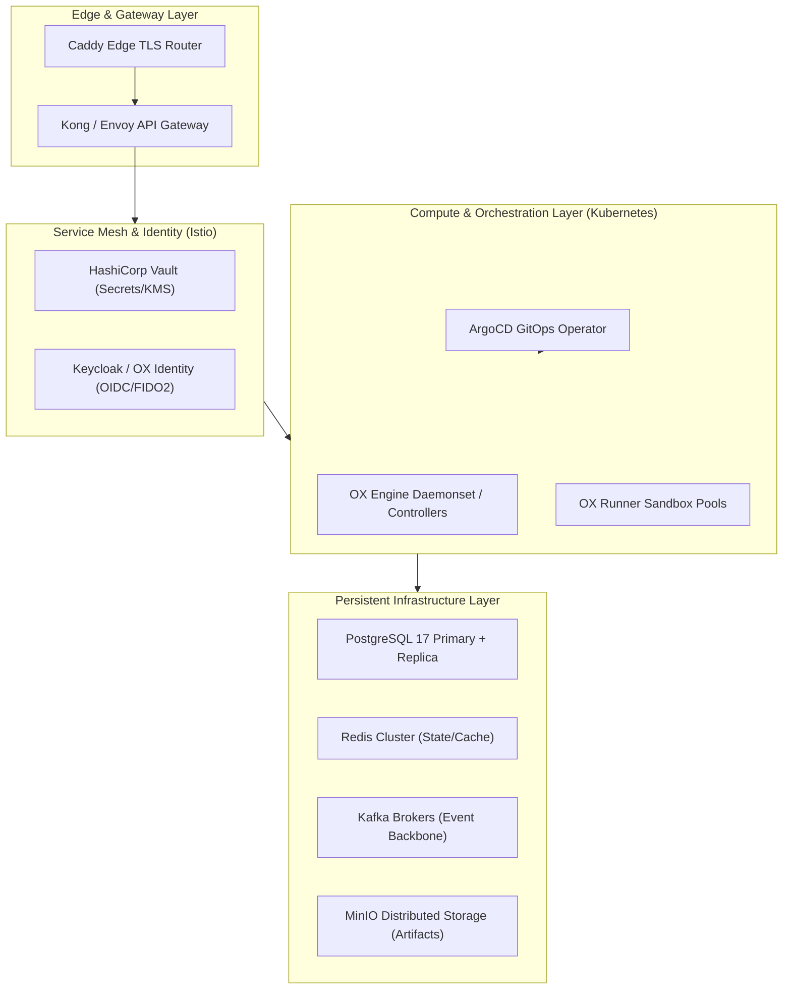

# OX ENGINE & OENEXAHUB
## The Cloud-Native, Banking-Grade Engineering Operating System
### Master Technical Specification, Repository Architecture, Development Standards & Operating Model

```
                                  OENEXAHUB
                    Unified Control Plane & Developer Portal
                 (Next.js · React · TypeScript · shadcn/ui · TanStack)
                                      │
                   gRPC / Protobuf v3 │ REST / OpenAPI v3
                                      ▼
                                  OX ENGINE
                  Enterprise Operating System (Go 1.23+ Core)
   ┌──────────────────────────────────┼──────────────────────────────────┐
   ▼                                  ▼                                  ▼
┌──────────────────────┐   ┌──────────────────────┐   ┌──────────────────────┐
│     ox-workflow      │   │      ox-runner       │   │       ox-agent       │
│  Pipeline DAG Parser │   │ Docker / K8s Runtime │   │ Autonomous AI Swarm  │
│    Job Scheduler     │   │   Isolated Sandboxes │   │  Review & Refactor   │
└──────────────────────┘   └──────────────────────┘   └──────────────────────┘
   ┌──────────────────────────────────┼──────────────────────────────────┐
   ▼                                  ▼                                  ▼
┌──────────────────────┐   ┌──────────────────────┐   ┌──────────────────────┐
│     ox-security      │   │     ox-evidence      │   │    ox-governance     │
│ Trivy/Semgrep/Falco  │   │ RFC 8785 Canonical   │   │ Four-Eyes & Law 7    │
│  OPA Policy Engine   │   │  SHA-256 Immutability│   │ Zero Legacy Guard    │
└──────────────────────┘   └──────────────────────┘   └──────────────────────┘
   ┌──────────────────────────────────┼──────────────────────────────────┐
   ▼                                  ▼                                  ▼
┌──────────────────────┐   ┌──────────────────────┐   ┌──────────────────────┐
│      ox-deploy       │   │    ox-monitoring     │   │     ox-identity      │
│  GitOps & ArgoCD Sync│   │ Prometheus / Grafana │   │ Passkeys / WebAuthn  │
│  Canary & Rollback   │   │ OpenTelemetry Tracing│   │  DPoP Token Binding  │
└──────────────────────┘   └──────────────────────┘   └──────────────────────┘
```

---

## 1. Executive Summary & Architectural Mandate

**OX Engine** is the engineering operating system powering **OENEXAHUB**. Following patterns established by industry-defining engineering organizations—**Google** (Borg/Piper), **GitHub** (Actions/Octokit), **GitLab** (AutoDevOps), **Backstage** (Service Catalog), **Stripe** (Sorbet/Internal DevX), **Coinbase** (Odin/Bifrost), and **Cloudflare** (Workers Runtime)—OX Engine unifies repository management, continuous verification, infrastructure management, automated security, compliance, autonomous agents, and release evidence into a single cohesive control plane.

OX Engine replaces fragmented third-party CI/CD runners (such as external GitHub Actions runners) with a completely self-hosted, sovereign, deterministic execution environment adhering to banking-grade safety laws:
- **Law 6 (Zero-Mock Invariant):** 100% deterministic test execution against real services or immutable state fixtures.
- **Law 7 (Code Brevity Ceiling):** Strictly $< 385$ lines of code per implementation file across `.ts`, `.tsx`, `.sol`, and `.go`.
- **Four-Eyes Governance:** Non-negotiable separation: $\text{Creator} \neq \text{Reviewer} \neq \text{Approver}$.
- **Zero Legacy Presence:** Guaranteed absence of legacy artifacts across code, configs, and schemas.

---

## 2. Technology Stack & Component Architecture

### 2.1 Technology Stack Matrix

| Domain | Technology Selection | Architectural Rationale & Standards |
| :--- | :--- | :--- |
| **Frontend Portal** | React 19, TypeScript 5.7+, Next.js 15, TailwindCSS v4, TanStack Query v5, shadcn/ui | Server-side rendering (SSR), streaming hydration, zero-localStorage token architecture, dark/light theme tokens. |
| **Backend Core** | **Go (Golang 1.23+)** | Ultra-high throughput, static single-binary compilation, sub-millisecond GC pauses, zero external runtime dependency, native concurrency primitives (`goroutines`, `channels`). |
| **Inter-Service IPC** | gRPC (HTTP/2), Protobuf v3, REST / OpenAPI v3 | Strongly typed contracts, binary wire serialization, backwards-compatible schema evolution, high-performance streaming. |
| **Primary Persistence** | PostgreSQL 17 (WAL-G PITR Enabled) | ACID-compliant transactional persistence, row-level security (RLS), relational integrity, JSONB semi-structured event logs. |
| **Cache & State** | Redis 7.4 (In-Memory Cluster) | Distributed locking (Redlock), pipeline execution lease arbitration, ephemeral session storage, rate limiting. |
| **Message Streaming** | Apache Kafka (Event Sourcing) | Durable append-only event logs, CNCF CloudEvents v1.0 standard, consumer group rebalancing, audit trail replayability. |
| **Log & Search** | OpenSearch 2.17 | Distributed full-text search, audit trail querying, SIEM log parsing, real-time developer search index. |
| **Object Storage** | MinIO (Self-Hosted) / S3-Compatible | S3 API-compatible immutable artifact storage, WORM (Write Once Read Many) policy, evidence sealing. |

### 2.2 Platform Infrastructure Stack



- **Container Runtime:** Docker Engine / containerd with gVisor / Kata Containers sandboxing for arbitrary runner jobs.
- **Orchestration:** Kubernetes v1.31+ with Horizontal Pod Autoscalers (HPA) and Custom Resource Definitions (CRDs).
- **GitOps Engine:** ArgoCD with declarative pull-based synchronization and automated drift reconciliation.
- **Infrastructure as Code:** Terraform with state locking in PostgreSQL/S3 and OPA policy checking.
- **Secrets Management:** HashiCorp Vault with dynamic ephemeral credential generation and SPIFFE/SPIRE workload attestation.
- **Service Mesh:** Istio with mTLS STRICT mode, transparent traffic encryption, and circuit breaking.

### 2.3 Observability & Telemetry Stack

- **Metrics Collection:** Prometheus agent scraping OpenTelemetry exporters at 5s intervals.
- **Visualization:** Grafana dashboards with executive, operational, and regulatory views.
- **Log Aggregation:** Grafana Loki with Promtail ingestion and structured JSON querying.
- **Distributed Tracing:** Grafana Tempo receiving OpenTelemetry traces with trace-to-logs correlation.
- **Unified Telemetry:** OpenTelemetry SDK injected into all Go and TypeScript binaries.
- **Alerting & Paging:** Prometheus AlertManager with SLA breach, error budget exhaustion, and security incident routing.

### 2.4 Security & Compliance Stack

```
   ┌──────────────────────────────────────────────────────────┐
   │                  SECURITY CONTROL PLANE                  │
   └─────────────────────────────┬────────────────────────────┘
                                 │
     ┌───────────────────────────┼───────────────────────────┐
     ▼                           ▼                           ▼
┌───────────────┐       ┌─────────────────┐       ┌─────────────────┐
│ Code Scanning │       │Container Guard  │       │Policy & Runtime │
│ • Semgrep SAST│       │ • Trivy Scanner │       │ • Falco eBPF    │
│ • Gitleaks    │       │ • Syft / Grype  │       │ • OPA Gatekeeper│
│ • OWASP ZAP   │       │ • Cosign Signing│       │ • Audit SIEM    │
└───────────────┘       └─────────────────┘       └─────────────────┘
```

- **Authentication:** FIDO2 / WebAuthn Passkeys, hardware security keys (YubiKey), DPoP (RFC 9449) token binding.
- **Authorization:** Fine-grained Attribute-Based Access Control (ABAC) with Open Policy Agent (OPA) Rego rules.
- **Vulnerability Management:** Semgrep (SAST), Trivy (Container & SBOM), Gitleaks (Secret Prevention), OWASP ZAP (DAST).
- **Runtime Threat Detection:** Falco kernel-level eBPF monitoring for privilege escalation, unexpected syscalls, or container escapes.
- **Dependency Health:** Renovate bot automated dependency updates with Dependency-Track vulnerability monitoring.
- **Regulatory Frameworks:** Automated checks for ISO 20022 messaging, FATF Travel Rule IVMS 101, and EU MiCA crypto-asset standards.

---

## 3. CI/CD Architecture: The OX Pipeline System

OX Engine replaces external CI/CD pipelines (such as GitHub Actions) with a single, sovereign execution pipeline engine: **OX Workflow**.

### 3.1 Pipeline Topology

```
                  ox.yaml Pipeline Lifecycle
  ┌─────────────────────────────────────────────────────────┐
  │ 1. VALIDATE ──► 2. SECURITY ──► 3. TEST ──► 4. BUILD    │
  │      ▲               ▲             ▲           ▲        │
  │      └───────────────┴─────────────┴───────────┘        │
  │                 Law 6 & Law 7 Guard                     │
  │                          │                              │
  │                          ▼                              │
  │ 5. PACKAGE ──► 6. DEPLOY ──► 7. VERIFY ──► 8. RELEASE   │
  │                                   ▲            ▲        │
  │                                   └────────────┘        │
  │                               Four-Eyes & Evidence Seal │
  └─────────────────────────────────────────────────────────┘
```

### 3.2 Canonical `ox.yaml` Specification

```yaml
version: "1.0.0"
name: oenexa-ecosystem-pipeline
pipeline:
  - id: validate
    name: Code Quality & Style Enforcement
    commands:
      - ox validate --strict
      - ox governance --law-7 --ceiling=384

  - id: security
    name: DevSecOps Vulnerability & Secret Audit
    commands:
      - ox security --gitleaks --semgrep --trivy
      - ox policy evaluate --opa=policies/banking.rego

  - id: test
    name: Zero-Mock Unit & Integration Suite
    environment:
      LAW_6_ZERO_MOCK: "strict"
    commands:
      - ox test --all --coverage --min=90.0

  - id: build
    name: Deterministic Production Compilation
    commands:
      - ox build --target=production --deterministic

  - id: package
    name: Container Packaging & SBOM Generation
    commands:
      - ox package --sbom --cosign-sign

  - id: deploy
    name: GitOps Environment Rollout
    target: production
    strategy: canary
    commands:
      - ox deploy --gitops --argocd --health-probe

  - id: verify
    name: Synthetic Health & SLO Compliance Check
    commands:
      - ox verify --synthetic --slo=99.99

  - id: release
    name: Evidence Sealing & Traceability Matrix Sync
    commands:
      - ox evidence generate --canonical-json --sha256
      - ox release seal --matrix-sync
```

### 3.3 Uniform Execution Targets

OX Workflow executes identically across all targets:
- **Local Developer Machine:** Fast sandbox container execution via `ox pipeline run`.
- **Docker Compose:** Isolated multi-service network for automated integration testing.
- **Kubernetes Cluster:** Scalable ephemerally provisioned pod sandboxes managed by `ox-runner`.
- **Cloud Runner Pools:** Bare-metal runners on dedicated VPS instances (`62.210.92.60`).

---

## 4. Repository Structure & Directory Conventions

### 4.1 Platform Repositories Directory (21 Dedicated Repositories)

```
OENEXA Platform Repositories
├── ox-engine          # Core operating system daemon, scheduler & kernel (Go)
├── ox-ui              # Developer portal & unified console (Next.js/React/shadcn)
├── ox-api             # Gateway OpenAPI & gRPC Protobuf definitions
├── ox-identity        # FIDO2, WebAuthn, Passkeys & SSO authority
├── ox-workflow        # Pipeline DAG parser, job engine & validator
├── ox-runner          # Sandbox job executor (Docker, K8s, gVisor)
├── ox-agent           # Autonomous AI engineering swarm service
├── ox-build           # Deterministic hermetic build orchestrator
├── ox-deploy          # GitOps deployment & rollout controller
├── ox-security        # Automated SAST, DAST, Secret & Container scanner
├── ox-governance      # Law 6, Law 7 & Four-Eyes policy enforcement
├── ox-policy          # OPA Rego policies & banking rules
├── ox-evidence        # Immutable RFC 8785 evidence collection service
├── ox-audit           # Tamper-evident SIEM and event log ledger
├── ox-monitoring      # Telemetry, OpenTelemetry collector & SLO engine
├── ox-catalog         # Microservice catalog & dependency graph
├── ox-notification    # Alerting, webhooks & Slack/PagerDuty routing
├── ox-compliance      # ISO 20022, FATF Travel Rule & MiCA validator
├── ox-cli             # Universal `ox` command-line utility
├── ox-sdk-go          # Official Golang client library
└── ox-sdk-ts          # Official TypeScript/JavaScript client library
```

### 4.2 Standard `ox-engine/` Directory Structure

```
ox-engine/
├── cmd/
│   ├── ox/                   # Universal CLI executable entrypoint
│   └── ox-server/            # Core engine gRPC / HTTP daemon
├── internal/
│   ├── config/               # Viper / environment configuration loader
│   ├── core/                 # Core engine domain entities & interfaces
│   ├── workflow/             # DAG parsing, topological sort & state machine
│   ├── runner/               # Process isolation, container runners, executor
│   ├── security/             # Token binding, policy evaluation, signatures
│   ├── governance/           # Law 7, Law 6, and Four-Eyes rule engine
│   ├── evidence/             # RFC 8785 Canonical JSON & SHA-256 hasher
│   ├── telemetry/            # Prometheus metrics, OpenTelemetry tracing
│   └── storage/              # PostgreSQL GORM/pgx, Redis, MinIO drivers
├── pkg/
│   ├── client/               # Reusable Go client library
│   └── proto/                # Compiled protobuf Go packages
├── api/                      # OpenAPI 3.1 REST specifications
├── proto/                    # Protobuf v3 gRPC definitions
├── configs/                  # Base configuration templates (yaml)
├── deployments/              # Kubernetes Helm charts & ArgoCD Application manifests
├── infrastructure/           # Terraform modules for cloud infrastructure
├── scripts/                  # Shell utilities (setup, verify, drill)
├── docs/                     # Architecture documentation and guides
├── testing/                  # Deterministic test fixtures & mock-free drivers
├── evidence/                 # Local evidence workspace before sync
├── security/                 # Semgrep, Gitleaks, and Trivy rule files
├── monitoring/               # Grafana dashboards & Prometheus alerts
└── workflows/                # Canonical pipeline definitions (ox.yaml)
```

---

## 5. Development Standards & Repository Mandates

### 5.1 Mandatory Repository Files

Every repository in the OENEXA ecosystem must contain the following 7 standard files in its root:
1. `README.md`: Purpose, prerequisites, quickstart, architecture summary, and maintainers.
2. `CONTRIBUTING.md`: Workflow rules, branch naming (`feat/`, `fix/`, `perf/`), and PR checklist.
3. `ARCHITECTURE.md`: High-level domain boundaries, component diagram, and invariants.
4. `SECURITY.md`: Vulnerability reporting protocol, encryption standards, and security SLA.
5. `ROADMAP.md`: Versioning milestones, active deliverables, and technical backlog.
6. `CODEOWNERS`: Explicit ownership mapping defining primary reviewers for every subsystem.
7. `LICENSE`: Legal licensing declaration (e.g. Apache 2.0 or Proprietary Commercial).

### 5.2 Uniform Developer Command Structure

Every repository must support the uniform `ox` command interface:

```bash
ox validate    # Executes format check, linters, and Law 7 line ceiling validation
ox security    # Executes secret detection, SAST vulnerability scan, and OPA rules
ox test        # Executes zero-mock test suite enforcing Law 6 (100% pass rate)
ox build       # Compiles production artifacts deterministically
ox deploy      # Triggers GitOps rollout or container deployment
ox audit       # Scans for legacy artifacts (oengo) and checks Four-Eyes rules
ox evidence    # Generates RFC 8785 Canonical JSON evidence with SHA-256 hash
```

---

## 6. Engineering Organization Operating Model

To scale OX Engine and OENEXAHUB across an institutional enterprise, engineering responsibilities are structured into 6 cross-functional platform teams:

```
                         ENGINEERING LEADERSHIP COUNCIL
                     (CTO · VP Engineering · Chief Architect)
                                      │
     ┌──────────────────┬─────────────┼─────────────┬──────────────────┐
     ▼                  ▼             ▼             ▼                  ▼
┌──────────┐      ┌──────────┐  ┌──────────┐  ┌──────────┐       ┌──────────┐
│ Platform │      │DevEx Team│  │ Security │  │AI Engin. │       │  Infra   │
│   Team   │      │          │  │   Team   │  │   Team   │       │   Team   │
└──────────┘      └──────────┘  └──────────┘  └──────────┘       └──────────┘
     │                  │             │             │                  │
     ▼                  ▼             ▼             ▼                  ▼
• OX Engine        • OX CLI      • OX Security • OX Agent         • K8s / Helm
• OX Workflow      • OX UI       • OX Identity • OX Automation    • Terraform
• OX Runner        • OX SDK      • Compliance  • Autonomous Ops   • ArgoCD / SRE
```

1. **Platform Team:** Owns the OX Engine daemon, OX Workflow DAG engine, and OX Runner sandboxes.
2. **Developer Experience (DevEx) Team:** Owns the `ox` CLI, OENEXAHUB UI console, and official SDKs (`ox-sdk-go`, `ox-sdk-ts`).
3. **Security Team:** Owns OX Security, Keycloak/OX Identity, WebAuthn passkeys, OPA policies, and compliance scanning.
4. **AI Engineering Team:** Owns OX Agent autonomous swarms, automated code review agents, refactoring, and AI verification.
5. **Infrastructure & SRE Team:** Owns Kubernetes clusters, Terraform IaC, ArgoCD, Prometheus/Grafana observability, and disaster recovery drills.
6. **Governance & Audit Team:** Owns engineering standards, Four-Eyes governance approval gates, evidence ledgers, and regulatory compliance.

---

## 7. Release Maturity Model (10 Levels of Excellence)

| Level | Maturity Tier | Capabilities & Quality Invariants |
| :---: | :--- | :--- |
| **1** | **Manual** | Manual compilation, ad-hoc terminal deployments, unrecorded changes. |
| **2** | **Automated Build** | Deterministic CI builds triggered on commit; artifact versioning. |
| **3** | **Automated Testing** | Comprehensive automated test execution; test coverage tracking. |
| **4** | **Automated Security** | Integrated SAST, secret leakage detection, and container vulnerability scanning. |
| **5** | **Evidence-Based Releases** | RFC 8785 Canonical JSON records with cryptographic SHA-256 evidence digests. |
| **6** | **Policy-as-Code** | Open Policy Agent (OPA) gates blocking non-compliant commits before merge. |
| **7** | **GitOps Deployment** | Declarative state synchronized via ArgoCD; automated rollbacks on failure. |
| **8** | **AI-Assisted Engineering** | Autonomous agents generating tests, reviewing PRs, and auditing dependencies. |
| **9** | **Autonomous Remediation**| Self-healing containers, automated crash loop recovery, and auto-rollback. |
| **10**| **Banking-Grade Engineering**| Strict Law 6 (zero-mock), Law 7 ($<385$ LoC), Four-Eyes verification, RTO $< 10\text{s}$, RPO $= 0$, zero legacy presence. |

---

## 8. Final Unified Ecosystem Topology

```
                                  OENEXAHUB
                    Central Engineering Management Portal
                                      │
   ┌──────────────────────────────────┴──────────────────────────────────┐
   ▼                                                                     ▼
OX Engine Core (Golang Daemon)                       OX Runner Sandbox Pools
• Workflow DAG Scheduler                              • Docker Sandbox Runtime
• GitOps ArgoCD Synchronizer                          • Kubernetes Ephemeral Pods
• Four-Eyes & Law 7 Guard                             • gVisor Secure Isolation
• OpenPolicyAgent Rego Enforcer                       • Hermetic Build Caching
   │                                                                     │
   └──────────────────────────────────┬──────────────────────────────────┘
                                      │
                   gRPC / Event Streams (Apache Kafka)
                                      ▼
                        OENEXA POLYREPO ECOSYSTEM
   ┌──────────────────────────────────┼──────────────────────────────────┐
   ▼                                  ▼                                  ▼
Layer-1 Consensus                Exchange Core                    Banking & UI
• oenexa-node (Go L1)           • oenexa-exchange (Matching)     • oenexa-ui (Portal)
• oenexa-validator (Staking)    • oenexa-market-data (Feeds)     • oenexa-pay (ISO 20022)
• oenexa-contracts (Solidity)   • oenexa-liquidity (AMM/RFQ)     • oenexa-identity (FIDO2)
```

---

## 9. Conclusion & Next Steps

This specification establishes **OX Engine** and **OENEXAHUB** as the single source of truth and operating system for all OENEXA products, repositories, AI agents, infrastructure, security controls, compliance processes, testing, releases, and deployments.
