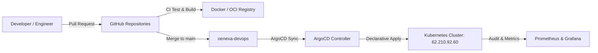

# DELIVERABLES 05-07: PLATFORM, DEVOPS & INFRASTRUCTURE ARCHITECTURE

**Document Version**: 2.0.0  
**Classification**: OENEXA Enterprise Architecture Standard  
**Authors**: Platform Architect, DevOps Engineer, Infrastructure Architect  

---

## 1. Deliverable 5: Platform Architecture (`oenexa-platform`)

The `oenexa-platform` repository operates as the foundational software substrate of the OENEXA engineering ecosystem. It enforces strict boundary rules to prevent architectural rot and cyclic coupling.

### 1.1 Invariant Boundary Rules
- **Rule 1 (Zero Business Logic)**: `oenexa-platform` is strictly forbidden from housing domain-specific calculations, pricing equations, orderbook models, or transaction validations.
- **Rule 2 (Zero Product Databases)**: It holds no database connections, migrations, or ORM entities.
- **Rule 3 (Strict Dependency Direction)**: Products and microservices depend on `oenexa-platform`. `oenexa-platform` NEVER depends on any product repository.

### 1.2 Package Architecture
```
oenexa-platform/packages/
├── design-tokens/     # Pure CSS variables: colors, typography, borders, z-indices
├── ui-shell/          # Framework-agnostic shell, header navigation, responsive layout
├── auth-sdk/          # OIDC/PKCE client, in-memory token management, auto-refresh
├── event-schemas/     # TypeScript interfaces and validators for CloudEvents v1.0
└── api-contracts/     # RFC 7807 problem details, standard API response envelopes
```

---

## 2. Deliverable 6: DevOps Architecture (`oenexa-devops`)

The DevOps architecture implements a pure GitOps paradigm. Production state equals git repository state.

### 2.1 GitOps Control Plane Architecture


### 2.2 Repository Directory Layout
```
oenexa-devops/
├── argocd/
│   ├── root-application.yaml     # App-of-apps bootstrap pattern
│   ├── project.yaml              # ArgoCD AppProject with destination restrictions
│   └── applications/             # Declarative specs for all microservices
├── helm/
│   └── oenexa-service/           # Unified enterprise Helm chart template
│       ├── Chart.yaml
│       ├── values.yaml
│       └── templates/            # Deployment, Service, Ingress, HPA, PodDisruptionBudget
├── environments/
│   ├── dev/                      # Non-production variable overrides
│   ├── staging/                  # Pre-production validation environment
│   └── prod/                     # Production hardened configurations
└── monitoring/
    ├── alertmanager.yaml         # PagerDuty & Slack routing
    └── prometheus-rules.yaml     # SLO error budget burn alerts
```

### 2.3 Deployment Governance & Promotion Model
1. **Pull Request Approval**: Minimum two Senior Peer Approvals + CI Greenfield passing.
2. **Automated Static & Dynamic Analysis**: Snyk container scan, Semgrep SAST, OPA Gatekeeper policy validation.
3. **Promotion Cadence**: Automatic merge to `dev` -> Manual QA sign-off to `staging` -> Canary release (10% -> 50% -> 100%) to `prod`.

---

## 3. Deliverable 7: Infrastructure Architecture (`oenexa-infra`)

All physical, cloud, and network resources are codified in Terraform (`oenexa-infra`). No console modifications or manual SSH reconfigurations are permissible.

### 3.1 Topology & Network Segmentation
- **Tier 1 (Public Edge)**: Cloudflare DNS with Anycast DDoS mitigation, Caddy Reverse Proxy TLS 1.3 termination.
- **Tier 2 (Demilitarized Application Zone)**: Kubernetes ingress controllers, public API gateways (`id.oenexa.com`, `rpc.oenexa.com`, `app.oenexa.com`).
- **Tier 3 (Isolated Microservice Subnet)**: High-throughput matching engines, AMM liquidity pools, dispatch services. No direct internet ingress.
- **Tier 4 (Data & Persistence Subnet)**: Sovereign PostgreSQL instances, Redis caching clusters, blockchain state persistence. Strict IP whitelist; zero external routing.

### 3.2 Terraform Module Structure
```
oenexa-infra/
├── modules/
│   ├── cloudflare-dns/           # Root, subdomains, wildcards, proxy status
│   ├── networking-vpc/           # Subnets, security groups, route tables
│   └── database-postgres/        # Isolated instances per domain, WAL-G archiving
└── environments/
    └── prod/
        ├── main.tf
        ├── variables.tf
        └── outputs.tf
```
