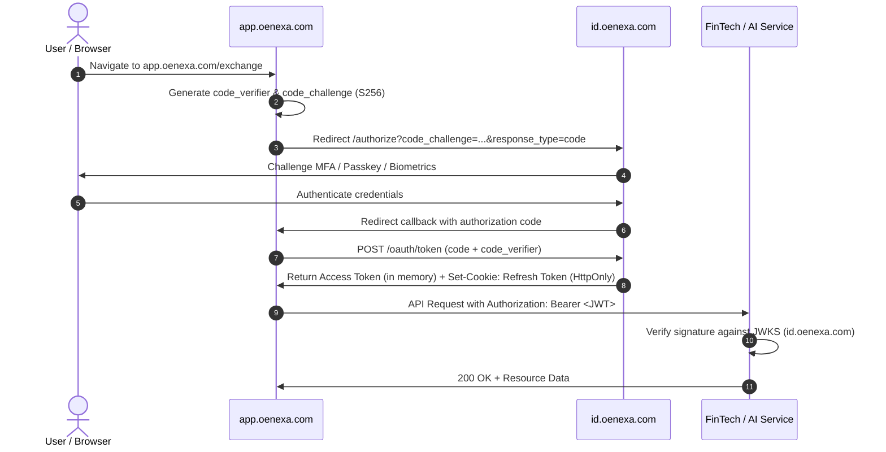

# DELIVERABLES 08-09: SECURITY & IDENTITY ARCHITECTURE

**Document Version**: 2.0.0  
**Classification**: OENEXA Enterprise Architecture Standard  
**Authors**: Security Architect, DevSecOps Engineer, IAM Architect  

---

## 1. Deliverable 8: Security Architecture (`oenexa-security`)

The OENEXA security architecture is rooted in a Zero-Trust operational paradigm. Trust is never implicit regardless of network locality.

### 1.1 Compliance Standards Alignment
- **OWASP ASVS Level 3**: Highest verification tier for financial microservices and cryptographic key operations.
- **OWASP API Security Top 10**: Enforced across all HTTP/2 and WebSocket endpoints.
- **PCI DSS v4.0 Scope Isolation**: `oenexa-pay` and cardholder data environments segregated into isolated VPC subnets with end-to-end tokenization.
- **SOC 2 Type II & ISO 27001**: Comprehensive audit trails, immutable ledger logs, and automated access recertification.

### 1.2 Admission Control via OPA Gatekeeper
All workloads deployed to the Kubernetes clusters must comply with Rego policies defined in `oenexa-security/gatekeeper/`:
- **Disallow Privileged Pods**: No container may run as root or possess `CAP_SYS_ADMIN`.
- **Mandatory Resource Limits**: Every container must explicitly declare CPU/Memory requests and limits to prevent noisy-neighbor starvation.
- **Immutable Root Filesystem**: Root filesystems must be mounted read-only; transient writes restricted to in-memory `tmpfs`.
- **Signed Image Enforcement**: Pods can only pull OCI images cryptographically signed via Cosign/Sigstore.

### 1.3 HashiCorp Vault Secrets Governance
- Zero plaintext secrets in Git, environment variables, or configmaps.
- Dynamic, short-lived database credentials generated via Vault Database Secrets Engine with automatic 1-hour rotation.
- Production Vault access restricted via Kubernetes ServiceAccount JWT verification.

---

## 2. Deliverable 9: Identity Architecture (`oenexa-identity`)

Identity is the single anchor of trust across the entire ecosystem. All services, APIs, and portals authenticate through `id.oenexa.com`.

### 2.1 Identity Standards & Protocols
- **RFC 8414 (OAuth 2.0 Authorization Server Metadata)**: Exposed at `https://id.oenexa.com/.well-known/openid-configuration`.
- **RFC 7517 (JSON Web Key Set)**: Exposed at `https://id.oenexa.com/.well-known/jwks.json` using RSA RS256 key pairs (`kid: oenexa-id-2026-v1`).
- **RFC 7636 (PKCE)**: Proof Key for Code Exchange using `code_challenge_method: S256` is mandatory for all browser clients.
- **FIDO2 / WebAuthn**: Sovereign Passkey support for hardware-backed, biometric multi-factor authentication.

### 2.2 Token Storage & Browser Security Rules
1. **Zero `localStorage` Storage**: Storing access tokens, refresh tokens, or user PII in `localStorage` or `sessionStorage` is strictly prohibited due to Cross-Site Scripting (XSS) extraction vulnerabilities.
2. **Volatile Memory Storage**: Access tokens are held exclusively in JavaScript memory (`@oenexa/auth-sdk`).
3. **Rotating Refresh Tokens in `HttpOnly` Cookies**: Refresh tokens are returned in encrypted, `HttpOnly`, `Secure`, `SameSite=Strict` cookies with cryptographically enforced token rotation on every exchange.

### 2.3 Authentication Flow Diagram

