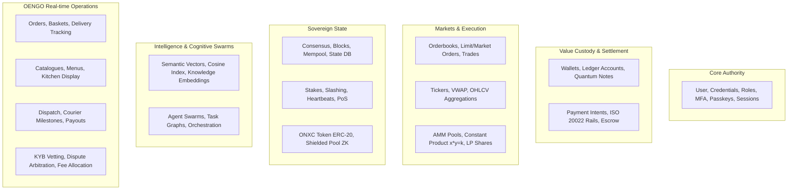

# DELIVERABLES 10-13: DOMAIN, DATA, INTEGRATION & API GOVERNANCE

**Document Version**: 2.0.0  
**Classification**: OENEXA Enterprise Architecture Standard  
**Authors**: Solution Architect, Database Engineer, API Engineer  

---

## 1. Deliverable 10: Domain Architecture

The OENEXA ecosystem is decomposed into bounded contexts using Domain-Driven Design (DDD):



---

## 2. Deliverable 11: Data Architecture & Storage Isolation

### 2.1 The Zero Shared Database Law
No microservice or application may directly connect to, query, or execute transactions against another service's database. Database credentials are mathematically isolated by network security groups and IAM.

### 2.2 Storage Engine Selection Matrix
| Domain Service | Storage Engine | Replication / Consistency | Justification |
| :--- | :--- | :--- | :--- |
| `oenexa-identity` | PostgreSQL 16 | Multi-AZ Synchronous Streaming | ACID compliance for authentication state & credentials |
| `oenexa-wallet` | PostgreSQL 16 | Synchronous Bi-directional Ledger | Strict double-entry accounting guarantees |
| `oenexa-exchange` | In-Memory Engine + RocksDB WAL | Snapshotting + Event Journaling | Ultra-low latency order matching (<1ms execution) |
| `oenexa-market-data` | TimescaleDB / Redis | High-frequency time-series cache | Optimized for OHLCV aggregation & sub-second candles |
| `oenexa-node` | LevelDB / Pebble | Distributed Byzantine Consensus | EVM state trie and block storage |
| `oenexa-rag` | pgvector / FAISS | In-memory index with vector persistence | 256/1536-dimensional semantic similarity lookups |
| `oengo-*` | PostgreSQL 16 | Read-Replica Segregated | Geographically partitioned regional delivery orders |

---

## 3. Deliverable 12: Integration Architecture (CloudEvents Standard)

Cross-domain asynchronous communication is governed by the CNCF CloudEvents v1.0 standard, codified in `@oenexa/event-schemas`.

### 3.1 Canonical Event Envelope
```json
{
  "specversion": "1.0",
  "id": "evt-1731548000-abcde",
  "source": "urn:oenexa:oengo:driver",
  "type": "oengo.driver.mission.delivered",
  "time": "2026-11-14T02:12:00.000Z",
  "datacontenttype": "application/json",
  "data": {
    "missionId": "msn-100",
    "orderId": "ord-500",
    "driverId": "drv-002",
    "totalEarned": 8.5
  }
}
```

### 3.2 Transactional Outbox Pattern
Every microservice implements the Transactional Outbox Pattern to guarantee at-least-once event delivery. Domain state mutations and outbox records are committed within a single local database transaction before publication to Kafka/RabbitMQ.

---

## 4. Deliverable 13: API Governance Strategy

### 4.1 RFC 7807 Problem Details
All API errors must return the RFC 7807 `application/problem+json` media type. Generic `{"error": "something went wrong"}` responses are rejected by CI API linters.

```json
{
  "type": "https://errors.oenexa.com/insufficient-liquidity",
  "title": "Insufficient Liquidity in Reserve",
  "status": 409,
  "detail": "Requested swap of 500 ONXC exceeds pool liquidity threshold of 2.5%",
  "instance": "/api/v1/pools/pool-001/swap",
  "code": "ERR_INSUFFICIENT_LIQUIDITY"
}
```

### 4.2 Mandatory API Headers
- `X-Correlation-ID`: Trace UUID propagated across all internal service hops.
- `Idempotency-Key`: Mandatory for all state-mutating requests (`POST`, `PUT`, `DELETE`). Stored in Redis with a 24-hour TTL to prevent double-charging or duplicate order placement.
