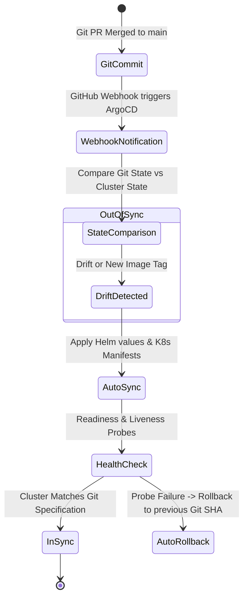

# DELIVERABLES 14-16: GITOPS, DEPLOYMENT & PRODUCTION OPERATIONS

**Document Version**: 2.0.0  
**Classification**: OENEXA Enterprise Architecture Standard  
**Authors**: Platform Engineer, Kubernetes Engineer, SRE Lead  

---

## 1. Deliverable 14: GitOps Governance Strategy

The OENEXA deployment model is 100% declarative and driven entirely by GitOps via ArgoCD.

### 1.1 Strict Prohibitions
- **NO SSH Deployments**: Direct SSH access into production container runtimes to modify code, config, or assets is disabled by host firewall.
- **NO `kubectl apply`**: Manual execution of `kubectl create`, `apply`, `edit`, or `delete` in production clusters is blocked by RBAC and admission webhooks.
- **NO Direct Cloud Console Changes**: Infrastructure modifications via AWS, GCP, or Cloudflare web consoles are flagged by CloudTrail / audit bots and automatically reverted.

### 1.2 The GitOps Reconciliation Loop

---

## 2. Deliverable 15: Deployment Strategy (Canary & Progressive Delivery)

All high-traffic microservices (`oenexa-ui`, `oenexa-identity`, `oenexa-exchange`, `oenexa-pay`) leverage Argo Rollouts for progressive canary delivery.

### 2.1 Canary Rollout Stages
1. **Stage 1 (Canary 10%)**: Directs 10% of global traffic to new container version for 15 minutes.
   - Analysis: Automated Prometheus metric check (HTTP 5xx error rate < 0.1%, P99 latency < 50ms).
2. **Stage 2 (Canary 50%)**: Directs 50% of global traffic for 30 minutes.
   - Analysis: Business metrics verification (order completion rate, payment success rate).
3. **Stage 3 (Full Promotion 100%)**: Traffic fully routed to new revision; old revision scaled to zero.

### 2.2 Instant Rollback Trigger
If the Prometheus SLO analyzer detects error budget consumption exceeding 2% during any rollout stage, the canary is aborted instantly, and 100% of traffic is returned to the stable version within 5 seconds without human intervention.

---

## 3. Deliverable 16: Production Operations Strategy

Production operations follows Site Reliability Engineering (SRE) principles defined by Google.

### 3.1 Operating Model Tiers
- **Tier 1 (Core Infrastructure & Consensus)**: SRE on-call rotation with 5-minute page response time (24/7/365).
- **Tier 2 (FinTech & Exchange Services)**: FinTech SRE on-call rotation with 10-minute response time.
- **Tier 3 (Commerce & Developer Tools)**: Business hours engineering support with 30-minute escalation SLA.

### 3.2 Change Management & Release Freeze Periods
- Regular deployments permitted Monday through Thursday between 08:00 UTC and 16:00 UTC.
- Deployments prohibited on Fridays, weekends, and major global market holidays, barring emergency hotfixes approved by the CTO and Incident Commander.
