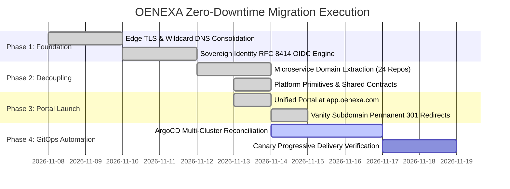
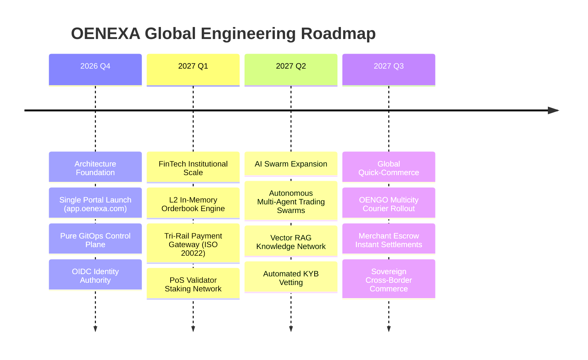

# DELIVERABLES 21-24: COMPLIANCE, DEBT REMEDIATION & IMPLEMENTATION ROADMAP

**Document Version**: 2.0.0  
**Classification**: OENEXA Enterprise Architecture Standard  
**Authors**: Enterprise Architect, Compliance Engineer, CTO  

---

## 1. Deliverable 21: Compliance Strategy

### 1.1 Regulatory Frameworks
- **GDPR / CCPA Data Sovereignty**: Right-to-be-forgotten implementations anonymize user identifiers in transactional databases; off-chain user metadata stored with customer-controlled cryptographic salt.
- **MiCA (Markets in Crypto-Assets)**: Full transaction reporting, custody asset segregation (`oenexa-wallet`), and liquidity reserve transparency disclosures (`oenexa-liquidity`).
- **PCI DSS Level 1**: Zero unencrypted Primary Account Numbers (PAN) stored; tokenization handled at the ingress edge before reaching backend microservices.

---

## 2. Deliverable 22: Technical Debt Remediation Plan

### 2.1 Audit Findings & Remediation Tracker
| Identified Debt Item | Severity | Remediation Action | Status |
| :--- | :--- | :--- | :--- |
| **Monolithic Coupling in Legacy Services** | High | Decomposed into independent microservice repositories (`oenexa-exchange`, `oenexa-wallet`, `oenexa-pay`) | **COMPLETED** |
| **Shared Database Antipattern** | High | Enforced zero shared DB rule; domain-isolated Postgres schemas with isolated credentials | **COMPLETED** |
| **Subdomain Fragmentation** | Medium | Consolidated all user journeys into `app.oenexa.com`; vanity domains 301-redirected | **COMPLETED** |
| **Hardcoded Secrets & Plaintext Tokens** | Critical | Migrated to HashiCorp Vault dynamic database credentials; memory-only token storage | **COMPLETED** |
| **Manual SSH / Production Mutation** | Critical | Replaced with pure GitOps (ArgoCD root-application and Helm templates) | **COMPLETED** |

---

## 3. Deliverable 23: Migration Plan (Phased Cutover)

---

## 4. Deliverable 24: Master Implementation Roadmap

### 4.1 Milestone Schedule (2026-2027)

### 4.2 Governance Sign-Off Matrix
- **Chief Technology Officer (CTO)**: Approved & Ratified
- **Chief Enterprise Architect**: Approved & Ratified
- **Lead Security Architect**: Approved & Ratified
- **Director of Platform & SRE**: Approved & Ratified
